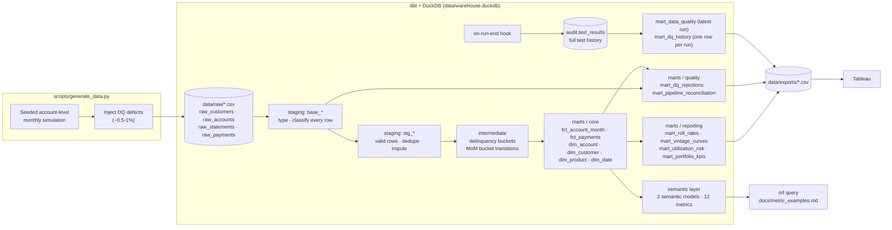

# card-portfolio-analytics

[](https://github.com/<your-github-username>/card-portfolio-analytics/actions/workflows/ci.yml)

> ⚠️ **All data in this repository is synthetic.** It is produced by a seeded simulation in
> `scripts/generate_data.py`. No real customers, accounts, institutions or bureau data are
> represented. Every pattern you see in the outputs - delinquency levels, the subprime and
> Student risk gap, utilization as a leading indicator, the Q4 spend spike - was **put there by
> the generator's assumptions**. They are not real-world findings and should not be cited as such.

An end-to-end analytics engineering project on a simulated credit card portfolio:
a seeded data generator, a layered **dbt + DuckDB** warehouse with tests and a MetricFlow
semantic layer, Tableau-ready exports, and CI on GitHub Actions.

It shows how to turn messy monthly statement and payment extracts into trustworthy
credit-risk reporting: delinquency buckets, roll rates, vintage loss curves, utilization as
a leading indicator, net charge-offs, and a data-quality audit trail that feeds a Data Trust dashboard.

## Architecture



| Layer | Schema | Materialization | Responsibility |
|---|---|---|---|
| Sources | `raw` (CSV read in place) | external | Raw extracts, all `VARCHAR`. Source tests are **warn** - they measure the defects. |
| Staging | `staging` | view / table | `base_*` type every raw row and label it with a `dq_status`; `stg_*` keep only `valid` rows, dedupe (latest load wins), forward-fill null FICO. |
| Intermediate | `intermediate` | table | `int_account_months` (bucket, utilization, months on book), `int_bucket_transitions` (prior bucket, transition type). |
| Core marts | `marts` | table | Star schema: `fct_account_month` (account x month), `fct_payments` (payment), `dim_account`, `dim_customer`, `dim_product`, `dim_date`. |
| Reporting marts | `marts` | table | Pre-aggregated Tableau feeds (below). |
| Quality marts | `marts` | table / view | Data Trust feeds (below). |
| Semantic layer | - | YAML | Semantic models on `fct_account_month` and `fct_payments`, 12 metrics, queried with MetricFlow. |

### Reporting marts (Tableau)

| Model | Grain | Use |
|---|---|---|
| `mart_portfolio_kpis` | month x product | Scorecard: active accounts, balances, 30/60/90+ rates, roll rate, gross/net charge-offs, NCO rate |
| `mart_roll_rates` | transition month x product x from-bucket x to-bucket | Roll-rate matrix; `roll_rate_pct` sums to 100 per from-bucket |
| `mart_vintage_curves` | origination quarter x product x months on book | Static-pool loss curves: cumulative ever-30+/60+, cumulative charge-off rate |
| `mart_utilization_risk` | observation month x product x FICO band x utilization band | Forward 3m 30+ / 6m 60+ bad rates for Current accounts |

### Quality marts (Data Trust dashboard)

| Model | Grain | Use |
|---|---|---|
| `mart_pipeline_reconciliation` | entity (statements, payments, accounts, customers) | Raw -> staged -> mart funnel: `raw_rows`, `rejected_*` by defect type, `staged_rows`, `mart_rows`, imputed / late-arriving counts. Tested: `raw - rejected = staged = mart`. |
| `mart_dq_rejections` | source table x DQ check | What staging did with each defect class (rejected / imputed / accepted-and-flagged) |
| `mart_data_quality` | test (latest run only) | Test name, model, severity, status, failures, run timestamp for the most recent run |
| `mart_dq_history` | dbt run | `run_ts`, `tests_total`, `passed`, `warned`, `errored` (+ `skipped`, `failing_rows`) for every run |

Every test result is appended to `audit.test_results` by an `on-run-end` hook
([`macros/test_results.sql`](macros/test_results.sql)). That table keeps the full history;
`mart_data_quality` and `mart_dq_history` are views over it, so they always reflect the latest
completed run. (During a build, tests on these two views see the *previous* run's log, because
the hook writes after all nodes finish.)

## Delinquency conventions

| Bucket | Days past due | Rank |
|---|---|---|
| Current | 0-29 | 0 |
| 30 | 30-59 | 1 |
| 60 | 60-89 | 2 |
| 90 | 90-119 | 3 |
| 120 | 120-149 | 4 |
| 150 | 150-179 | 5 |
| CO | 180 - charged off; final month for the account | 6 |

"Active" = open and not charged off in the month (`delinquency_bucket <> 'CO'`). "30+" = buckets
30 through 150. Charge-off balances are recognised in the 180 DPD month; recoveries are payments
received after charge-off. A roll forward is any increase in bucket rank month over month.

## Metric definitions (semantic layer)

Defined in [`models/semantic/_semantic_models.yml`](models/semantic/_semantic_models.yml); each
metric carries `owner`, `formula` and `grain` in `config.meta`.

| Metric | Type | Formula | Grain | Owner |
|---|---|---|---|---|
| `active_accounts` | simple | `COUNT(account months WHERE bucket <> 'CO')` | account x month | Credit Risk Analytics |
| `delinquency_rate_30plus` | ratio | `COUNT(active, 30 <= DPD < 180) / COUNT(active)` - buckets 30, 60, 90, 120, 150 | account x month | Credit Risk Analytics |
| `utilization_rate` | ratio | `SUM(balance) / SUM(credit_limit)`, active accounts | account x month | Portfolio Management |
| `roll_rate` | ratio | `COUNT(bucket rank worsened vs t-1) / COUNT(accounts with a t-1 row)`; slice by `prior_delinquency_bucket` for Current->30 ... 150->CO | account x month transition | Credit Risk Analytics |
| `net_charge_off_rate` | derived | `12 * (gross charge-offs - recoveries) / receivables` | month | Finance - Credit Loss Reporting |

Component metrics: `dpd30_plus_accounts`, `receivables`, `credit_lines`, `roll_forward_accounts`,
`roll_eligible_accounts`, `gross_charge_offs`, `recoveries`.

`make metrics` runs example MetricFlow queries and writes them to
[`docs/metric_examples.md`](docs/metric_examples.md), for example:

```bash
mf query --metrics delinquency_rate_30plus --group-by metric_time__month,account_month__product_name --start-time 2025-01-01
```

## Synthetic data

`scripts/generate_data.py` simulates every account month by month (seeded, vectorised NumPy):

- **Defaults:** 50,000 accounts (~43,000 customers), 36 reporting months Jan 2023 - Dec 2025.
  ~40% of accounts were originated before the window (seasoned book); the rest originate inside it.
- **Products:** Cashback, Travel, Student, Platinum with product-specific FICO, limit and APR distributions.
- **Behaviour:** transactors / revolvers / minimum payers; interest, late fees, declines at the limit.
- **Risk (by construction):** a latent AR(1) "stress" factor raises spend and lowers payment
  rates *before* it raises delinquency, which makes utilization a leading indicator. The
  generator raises roll probability for subprime FICO (< 620) and Student cards and adds
  post-holiday payment stress in Jan/Feb.
- **Seasonality (by construction):** Q4 spend multiplier (Nov/Dec), visible in balances and `net_new_charges`.
- **Loss:** 180 DPD triggers charge-off; ~35% of charge-offs produce recovery payments.

### Injected data-quality defects (and how staging handles them)

| Defect | Raw table | ~Rate | Staging action |
|---|---|---|---|
| Exact duplicate statement rows | raw_statements | 0.4% | Rejected (`exact_duplicate`) |
| Restatements: stale preliminary row + late corrected row | raw_statements | 0.3% | Latest load wins; stale row rejected (`superseded_restatement`) |
| Late-arriving statements | raw_statements | 0.2% (+ restated) | Accepted, flagged `is_late_arriving` |
| Null `fico_refresh` | raw_statements | 0.7% | Forward-filled from last reported score, flagged `is_fico_imputed` |
| Negative payments | raw_payments | 0.5% | Rejected (`non_positive_amount`) |
| Duplicate `payment_id` re-deliveries | raw_payments | 0.2% | First delivery kept (`duplicate_payment_id`) |
| Orphan payments (unknown account) | raw_payments | 0.05% | Rejected (`orphan_account`) |
| Late-arriving payments | raw_payments | 0.3% | Accepted, flagged |

## Tests

`dbt build` runs 1 seed, 22 models and **134 data tests** (123 severity `error`, 11 severity `warn`):

- **Generic:** `unique`, `not_null`, `relationships`, `accepted_values` on every key and categorical column.
- **Custom generic** (`tests/generic/`):
  - `balance_within_limit` - balance <= credit limit x 1.1 (**warn**)
  - `no_gaps_in_months` - every account has a contiguous run of months (**error**)
  - `rows_sum_to` - roll-rate rows sum to 100% per from-bucket (**error**)
  - `unique_combination` (grain), `expression_is_true` (ranges, reconciliation identities)
- **Singular** (`tests/singular/`): no DQ leakage into marts (error), charge-off is terminal at
  180 DPD (error), payments reconcile to statements (warn), monthly 30+ rate within 1-8% (warn).

A clean run ends `PASS=156 WARN=3 ERROR=0`. The 3 warnings are the raw-source tests detecting
the injected null FICOs, duplicate payment ids and orphan payments - by design (see below).

## Design decisions

- **Load timestamps on every raw table.** The spec'd raw columns carry no ingestion metadata,
  but late-arriving records and restatements can't be distinguished without one. Each extract
  has `_loaded_at`; staging resolves "latest load wins" per natural key and flags rows that
  landed well after their business date.
- **`base_*` models before `stg_*`.** Instead of silently filtering bad rows, `base_statements`
  and `base_payments` keep *every* raw row with a `dq_status` label. `stg_*` select only `valid`
  rows, and the quality marts count everything else. Nothing is dropped without being reported,
  and `raw - rejected = staged = mart` can be tested.
- **12-month burn-in in the generator.** The simulation starts 12 months before the reporting
  window and discards those months, so the book enters Jan 2023 with seasoned balances and
  realistic delinquency stock rather than everyone starting Current at zero.
- **Warn vs error severity.** `error` = the mart would be wrong (keys, grain, referential
  integrity, gaps, roll-rate completeness, leakage). `warn` = worth a human look but not a reason
  to block the pipeline: raw-source checks (defects are *expected* there and are fixed downstream)
  and business-plausibility checks (over-limit balances, payment reconciliation, 30+ rate band).
- **Daily date spine.** Facts are monthly, but `dim_date` is daily (2018-2027) so it can serve as
  the MetricFlow time spine, which requires day granularity, and so Tableau can join any
  date-grained field. Monthly facts join on `date_day = statement_month`; the Tableau export
  filters it to month starts (`dim_date_monthly.csv`).
- **Aggregates only to Tableau.** Row-level facts (~1.2M account months, ~1.4M payments) stay in
  DuckDB; dashboards use the pre-aggregated marts, so exports stay under 1 MB.

## How to run

Requires Python 3.11.

```bash
make setup     # create .venv and install requirements
make all       # = make data build export
make metrics   # example MetricFlow queries -> docs/metric_examples.md
```

| Target | What it does |
|---|---|
| `make data` | Generate raw CSVs into `data/raw/` (`ACCOUNTS=`, `MONTHS=`, `SEED=` overridable) |
| `make build` | `dbt build` (seed, run, test) + `dbt docs generate` |
| `make export` | Export the Tableau marts to `data/exports/*.csv` |
| `make metrics` | Run example `mf query` commands and save output to `docs/metric_examples.md` |
| `make docs` | Serve dbt docs at http://localhost:8080 |
| `make clean` | Remove warehouse, generated CSVs and dbt artifacts |

Small sample: `make all ACCOUNTS=3000`.

CI ([`.github/workflows/ci.yml`](.github/workflows/ci.yml)) runs on every push: install,
generate a 3,000-account sample, `dbt build`, `dbt docs generate`, export, and print the
data-quality summary.

### Tableau exports (default settings)

| File | Rows | Size |
|---|---|---|
| mart_portfolio_kpis.csv | 144 | 28.5 KB |
| mart_roll_rates.csv | 2,167 | 254.1 KB |
| mart_vintage_curves.csv | 840 | 96.2 KB |
| mart_utilization_risk.csv | 3,330 | 331.6 KB |
| mart_dq_rejections.csv | 8 | 0.6 KB |
| mart_data_quality.csv | 134 | 40.4 KB |
| mart_dq_history.csv | 1 per run | 0.2 KB |
| mart_pipeline_reconciliation.csv | 4 | 0.6 KB |
| dim_product.csv | 4 | 0.5 KB |
| dim_date_monthly.csv | 120 | 9.7 KB |

## Generated outputs at default settings (seed 42)

These numbers describe the synthetic data and confirm the generator is calibrated as intended.
They are not observations about any real portfolio.

| Table | Rows |
|---|---|
| raw_statements -> fct_account_month | 1,175,116 -> 1,166,949 |
| raw_payments -> fct_payments | 1,396,053 -> 1,385,662 |
| raw_accounts / raw_customers | 50,000 / 43,000 |

| Measure | Value |
|---|---|
| 30+ DPD rate (accounts, 36-month pooled) | 3.53% (monthly range 3.16%-4.27%) |
| Net charge-off rate (annualized, pooled) | 3.37% |
| Roll rates Current->30 / 30->60 / 60->90 / 90->120 / 120->150 / 150->CO | 1.4% / 35.6% / 59.3% / 75.1% / 83.4% / 90.6% |

## Repository layout

```
scripts/             generate_data.py, export_for_tableau.py, metric_examples.py
models/staging/      sources, base_* (classified raw) and stg_* (clean) models
models/intermediate/ bucket and transition logic
models/marts/        core/ (facts + dims), reporting/ (Tableau aggs), quality/ (Data Trust)
models/semantic/     semantic models and metrics
macros/              bucket/band macros, schema naming, test-result audit hook
tests/generic/       custom generic tests;  tests/singular/  singular tests
seeds/               product_catalog.csv
docs/                metric_examples.md
```
